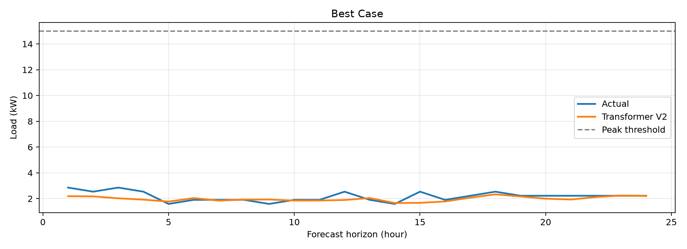
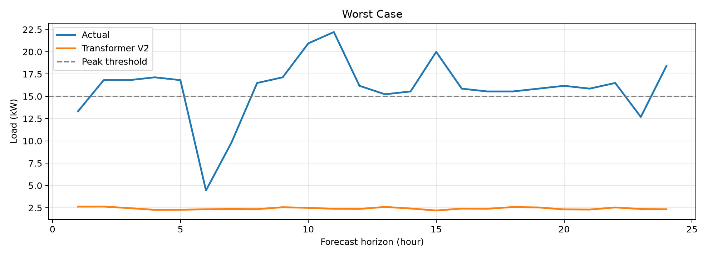
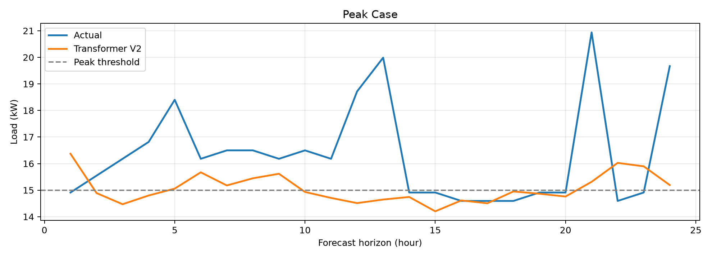
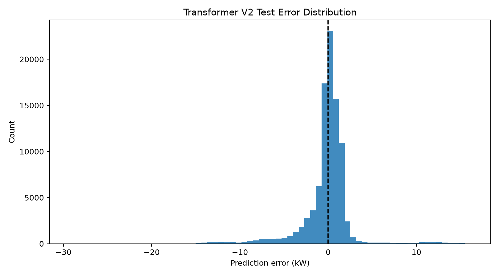
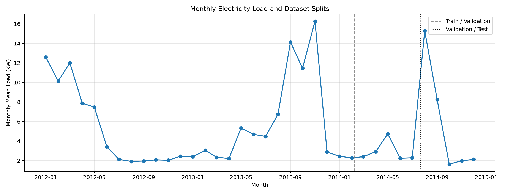
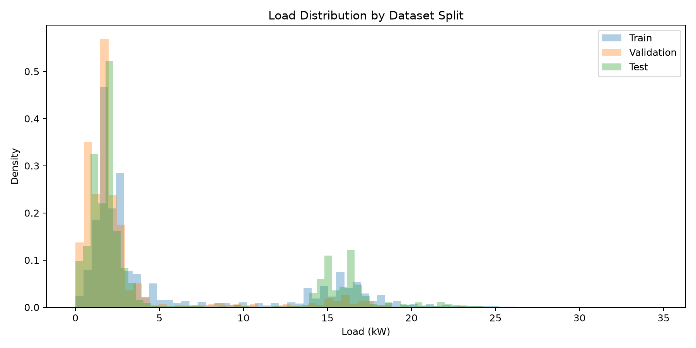
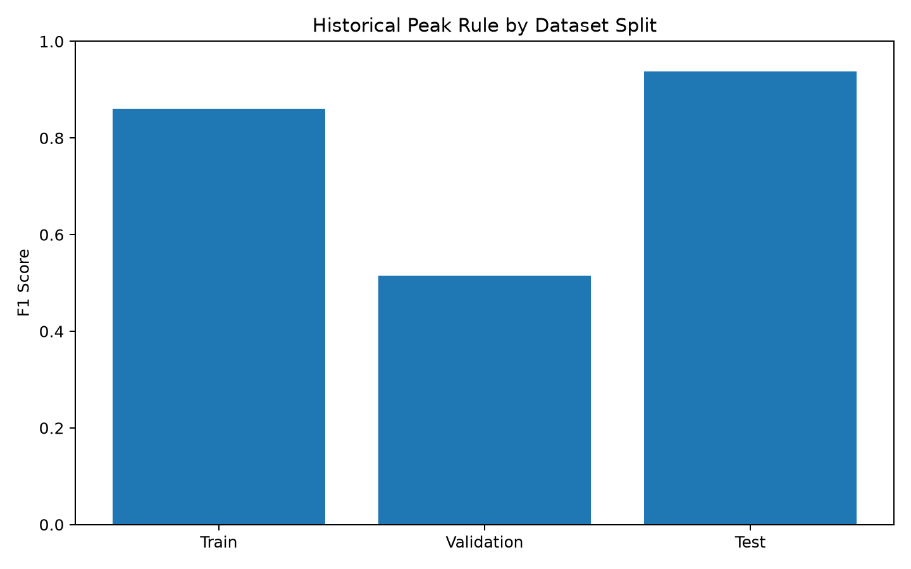

# Electricity Load Forecasting with Transformer

**24-Hour Load Forecasting | Peak Risk Detection | Distribution Shift Analysis**

An end-to-end electricity load forecasting project built with PyTorch. The project uses a Transformer to predict electricity demand over the next 24 hours from 168 hours of historical observations and calendar features.

Beyond forecasting accuracy, this project investigates extreme-load prediction, interpretable peak-risk baselines, and temporal distribution shift.

## 1. Project Overview

Short-term electricity load forecasting is important for energy management systems, battery energy storage scheduling, and peak demand management.

This project explores:

- Transformer-based multi-step electricity load forecasting
- Comparison with alternative forecasting models
- High-load prediction performance
- Peak-risk detection using historical persistence
- Distribution shift across chronological data splits

## 2. Dataset

The dataset contains **26,304 hourly observations** spanning January 2012 to December 2014.

The data is divided chronologically to avoid using future observations during model training.

| Split | Hours | Percentage |
|---|---:|---:|
| Training | 18,412 | 70% |
| Validation | 3,946 | 15% |
| Test | 3,946 | 15% |

**Input features**

- Historical electricity load (kW)
- Hour-of-day sine and cosine encoding
- Day-of-week sine and cosine encoding

**Forecasting setup**

| Parameter | Value |
|---|---|
| Historical input window | 168 hours |
| Prediction horizon | 24 hours |
| Model | Transformer |
| Framework | PyTorch |
| Training objective | Mean Squared Error (MSE) |

Normalization statistics are calculated exclusively from the training period.

## 3. Methodology

### Transformer Forecasting

The Transformer processes 168 hours of historical load and calendar features to produce a direct 24-hour forecast.

The model learns temporal dependencies and recurring load patterns through self-attention.

### Baseline Comparisons

Several forecasting approaches were investigated, including alternative Transformer configurations and a LightGBM regression baseline.

The final Transformer V2 model was selected based on validation performance.

### Peak Risk Detection

A simple historical persistence rule is evaluated:

**If the previous 24 hours contain a load value ≥15 kW, predict that at least one load value ≥15 kW will occur in the next 24 hours.**

This is a window-level peak-risk indicator, not a prediction of the exact peak hour.

## 4. Forecasting Performance

### Transformer V2

| Metric | Validation | Test |
|---|---:|---:|
| MAE (kW) | 1.9690 | **1.5272** |
| RMSE (kW) | 3.6687 | **2.8279** |
| Bias (kW) | +0.1366 | −0.1838 |

The test period exhibits lower overall forecasting errors than the validation period. This difference should be interpreted alongside changes in the underlying load distribution.

### High-Load Forecasting

| Actual load threshold | Test MAE (kW) | Threshold recall |
|---|---:|---:|
| ≥5 kW | 2.9831 | 92.81% |
| ≥10 kW | 2.8656 | 92.94% |
| ≥15 kW | 3.5295 | 24.28% |
| ≥20 kW | 7.8927 | 0.00% |

Although overall forecasting accuracy is reasonable, extreme-load magnitudes remain challenging.

## 5. Peak Risk Detection

A historical 24-hour persistence rule is compared against direct peak detection from Transformer V2 forecasts.

| Method | Validation F1 | Test F1 |
|---|---:|---:|
| Historical 24-hour rule | 0.5154 | **0.9377** |
| Transformer V2 direct peak detection | 0.1862 | 0.8830 |

These results reflect rolling 24-hour windows, which overlap substantially. They should not be interpreted as independent peak-event detection rates.

The persistence rule performs particularly well during periods when high-load conditions continue across adjacent days.

## 6. Distribution Shift Analysis

Substantial differences are observed across chronological data splits.

| Statistic | Training | Validation | Test |
|---|---:|---:|---:|
| Mean load (kW) | 5.7442 | 2.8704 | 5.6114 |
| Standard deviation (kW) | 6.1817 | 3.9658 | 6.5244 |
| Hours with load ≥15 kW | 16.15% | 5.12% | 17.74% |
| High-load events | 766 | 39 | 119 |

The validation period contains substantially fewer high-load hours than the training and test periods.

The test period also contains longer continuous high-load events, which helps explain the strong performance of the historical persistence baseline.

These observations demonstrate the importance of evaluating forecasting systems under changing operating conditions.

## 7. Visualizations

### Forecast Examples

**Lowest-error forecasting window**



**Highest-error forecasting window**



**High-load forecasting example**



### Error Distribution



### Distribution Shift







## 8. Project Structure

```text
Electricity-Load-Transformer/
├── data/
│   └── hourly_load.csv
├── dataset_v2.py
├── model_v2.py
├── train_v2.py
├── train_lightgbm.py
├── train_peak_classifier.py
├── final_evaluation.py
├── analyze_distribution_shift.py
├── models/
│   └── best_transformer_v2.pth
├── outputs/
│   ├── final_evaluation/
│   └── distribution_shift/
├── requirements.txt
└── README.md
```

## 9. Installation

Install the required Python packages:

```bash
pip install -r requirements.txt
```

## 10. Usage

Train the Transformer:

```bash
python train_v2.py
```

Run the final evaluation:

```bash
python final_evaluation.py
```

Analyze distribution shift:

```bash
python analyze_distribution_shift.py
```

## 11. Key Findings

1. Transformer-based forecasting captures general electricity load patterns, but extreme-load prediction remains difficult.
2. Historical peak persistence provides a strong and interpretable baseline in certain operating regimes.
3. Peak detection performance can vary significantly across time periods.
4. Distribution shift is an important consideration when evaluating load forecasting models.
5. Overall regression accuracy and peak-risk detection should be assessed separately.

## 12. Limitations and Future Work

The current approach uses historical load and calendar features without external operational or environmental variables.

Potential extensions include:

- Weather-aware load forecasting
- Regime-aware forecasting
- Probabilistic prediction intervals
- Improved extreme-load modeling
- Integration with battery energy storage optimization

## 13. Potential Applications

- Energy Management Systems (EMS)
- Battery Energy Storage Systems (BESS)
- Building electricity demand forecasting
- Peak demand monitoring
- Data-driven energy optimization

This project is an experimental study and has not been validated for production deployment.